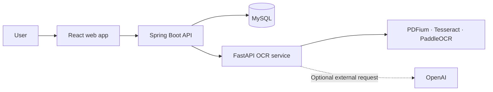

# PDF OCR & AI Document Archive

> [!NOTE]
> **To read this README in Korean, [open the Korean version](./docs/README.ko.md) or access `docs/README.ko.md`.**

A web application for extracting text from PDFs with OCR and managing document processing results and run history in one place. Choose an OCR engine to process a document, then review the results and, when configured, an AI-generated summary.

> **Project presentation** · [Mini Project Presentation (PDF)](../docs/presentation-miniproject-en.pdf)

## Project at a Glance

| Item | Details |
| --- | --- |
| Project | PDF OCR and document management web application |
| Key features | User authentication, PDF uploads, OCR processing, document and run history, result exports, AI summaries |
| Client | React 19, Vite |
| API server | Java 17, Spring Boot |
| OCR service | Python 3.12, FastAPI |
| Database | MySQL 8 |
| Runtime | Docker Compose |

## Features

- **Authentication and document management**: Sign up and log in to browse your documents and view document-level results.
- **PDF uploads and asynchronous processing**: Upload PDFs up to 20 MB and track their processing status. The detail page periodically refreshes while a run is in progress.
- **OCR engine selection**: Choose from AUTO, PDFIUM, TESSERACT, PADDLE, and OPENAI. The application reports engine availability based on the server's network mode and configuration.
- **Reprocessing and run history**: Reprocess a document with a different engine and review the results of each processing run.
- **Use document results**: View the original PDF and extracted images, and export OCR results.
- **Optional AI features**: Configure OpenAI to enable document summaries. The UI warns users that selecting the OpenAI engine sends the document to an external service.

## Architecture



The web app uses the Spring Boot API for authentication and document management. Spring Boot stores document metadata and run information in MySQL, and sends OCR processing requests to the Python FastAPI service. OpenAI integration is used only when configured and selected.

## Design and Implementation Highlights

- **Separation of responsibilities**: The web UI, document and authentication API, and OCR processing run as separate services.
- **Run-based processing history**: Documents and OCR runs are managed separately, so reprocessing creates a distinct result while preserving earlier runs.
- **Asynchronous processing experience**: Upload requests are accepted first, and users can track processing status from the document detail page.
- **Engine and network status visibility**: Available OCR engines and external data transfers are surfaced to help users make informed choices.
- **Per-user access control**: JWT authentication is used, and document APIs operate on documents belonging to the authenticated user.

## Tech Stack

| Area | Technologies |
| --- | --- |
| Frontend | React 19, React Router, Vite, JavaScript |
| Backend API | Java 17, Spring Boot, Spring Data JPA, Spring Security, JWT |
| OCR / AI API | Python 3.12, FastAPI, Pydantic |
| OCR / PDF | PDFium, Tesseract, PaddleOCR, PDF processing tools |
| Database | MySQL 8 |
| Infrastructure | Docker, Docker Compose |

## Getting Started

### Prerequisites

- Docker and Docker Compose
- An OpenAI API key and model configuration if you want to use AI summaries or the OpenAI OCR engine

### Configure environment variables

The repository does not include an `infra/.env.example` file. Create an `infra/.env` file, copy the example below, and replace the passwords, JWT secret, and OpenAI values with your own.

```env
# Web, backend, and OCR service ports
WEB_FRONTEND_PORT=50001
SPRING_SERVER_PORT=60001
PYTHON_SERVER_PORT=60100

# MySQL container and connection settings
# MYSQL_PORT is the host port; MYSQL_CONTAINER_PORT is the container port.
MYSQL_HOST=ocr-mysql
MYSQL_PORT=3307
MYSQL_CONTAINER_PORT=3306
MYSQL_DATABASE=ocrdb
MYSQL_USER=user
MYSQL_PASSWORD=change-me
MYSQL_ROOT_PASSWORD=change-me-too

# MySQL connection settings used by Spring Boot inside Docker
SPRING_MYSQL_HOST=ocr-mysql
SPRING_MYSQL_PORT=3306
SPRING_MYSQL_DATABASE=ocrdb
SPRING_MYSQL_USER=user
SPRING_MYSQL_PASSWORD=change-me
JWT_SECRET=replace-with-a-random-secret-at-least-32-bytes-long

# OCR service URL and client used by Spring Boot
APP_OCR_BASE_URL=http://agent-model:60100
APP_OCR_CLIENT=fastapi

# OCR service settings
APP_NAME=ocr-api
APP_VERSION=0.1.0
APP_ENV=development
NETWORK_ENV=OPEN
ENGINE=PDFIUM
OPENAI_API_KEY=your-openai-api-key
OPENAI_MODEL=your-openai-model
AI_TIMEOUT_SECONDS=30
AI_MAX_OUTPUT_TOKENS=1000
```

`MYSQL_PORT=3307` is an example host port chosen to avoid conflicts with a local MySQL instance. Spring Boot connects to MySQL inside Docker through `SPRING_MYSQL_PORT=3306`. If the host port is already in use, change only `MYSQL_PORT`. Use a randomly generated `JWT_SECRET` of at least 32 bytes. Do not commit real passwords or API keys to the repository.

> **OpenAI configuration required**: The OCR service currently validates its default OCR engine as `OPENAI`, and Docker Compose does not pass a `DEFAULT_OCR_ENGINE` value to the service. With the current configuration, set a valid `OPENAI_API_KEY` and `OPENAI_MODEL` to start the OCR service. To run without OpenAI, update both the environment variables passed by Compose and the OCR service's default engine configuration.

### Run the services

```bash
cd infra
docker compose up --build
```

When the services are up, open the web app on the port configured in `.env`. The published ports for each service are also configured there.

## API Overview

| Service | Endpoint | Description |
| --- | --- | --- |
| Spring Boot | `POST /api/v1/auth/signup` | Create an account |
| Spring Boot | `POST /api/v1/auth/login` | Log in and receive an access token |
| Spring Boot | `GET /api/v1/engines` | List OCR engines and network mode |
| Spring Boot | `/api/v1/documents` | Upload, list, view, and delete documents |
| Spring Boot | `/api/v1/documents/{id}/reprocess` | Reprocess a document |
| Spring Boot | `/api/v1/documents/{documentId}/runs` | List a document's processing runs |
| OCR service | `GET /api/v1/ocr/engines` | Check OCR service engine availability |
| OCR service | `POST /api/v1/ocr/extract` | Extract PDF text and return a summary |

## Repository Structure

```text
.
├── backend/       # Spring Boot API, authentication, documents, and run history
├── infra/         # Docker Compose and MySQL schema
├── ocr_api/       # FastAPI OCR/AI service and tests
├── web/           # React web client
└── presentation-miniproject-en.pdf
```
