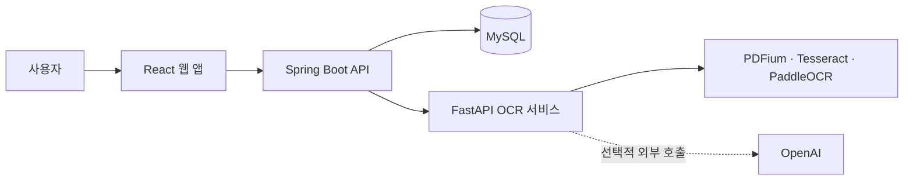

# PDF OCR & AI 문서 아카이브

업로드한 PDF를 OCR로 텍스트화하고, 처리 결과와 실행 이력을 한곳에서 관리하는 웹 애플리케이션입니다. OCR 엔진을 선택해 문서를 처리하고, 필요할 때 AI 요약을 확인할 수 있습니다.

> **프로젝트 발표 자료** · [Mini Project Presentation (PDF)](../docs/presentation-miniproject-ko.pdf)

## 프로젝트 한눈에 보기

| 항목 | 내용 |
| --- | --- |
| 프로젝트 | PDF 문서 OCR 및 결과 관리 웹 서비스 |
| 주요 기능 | 회원 인증, PDF 업로드, OCR 처리, 문서·실행 이력 관리, 결과 내보내기, AI 요약 |
| 클라이언트 | React 19, Vite |
| API 서버 | Java 17, Spring Boot |
| OCR 서비스 | Python 3.12, FastAPI |
| 저장소 | MySQL 8 |
| 실행 환경 | Docker Compose |

## 주요 기능

- **회원 인증과 문서 관리**: 회원가입·로그인 후 내 문서 목록을 조회하고, 문서별 상세 결과를 확인합니다.
- **PDF 업로드 및 비동기 처리**: 최대 20MB PDF를 업로드하고 처리 상태를 확인합니다. 처리 중인 작업은 상태를 주기적으로 갱신합니다.
- **OCR 엔진 선택**: AUTO, PDFIUM, TESSERACT, PADDLE, OPENAI 엔진을 제공하고, 서버의 네트워크 모드와 설정에 따라 사용 가능한 엔진을 안내합니다.
- **재처리와 실행 이력**: 같은 문서를 다른 엔진으로 다시 처리하고, 각 처리 실행(run)의 결과를 확인합니다.
- **문서 결과 활용**: 원본 PDF와 추출 이미지를 확인하고 OCR 결과를 내보낼 수 있습니다.
- **선택형 AI 기능**: OpenAI 설정을 완료하면 문서 요약을 사용할 수 있습니다. OpenAI 엔진 선택 시 문서가 외부 서비스로 전송됨을 UI에서 알립니다.

## 아키텍처



웹 앱은 Spring Boot API를 통해 인증과 문서 관리를 수행합니다. Spring Boot는 문서 메타데이터와 실행 정보를 MySQL에 저장하고, OCR 처리를 Python FastAPI 서비스에 요청합니다. OpenAI 연동은 설정 및 선택에 따라 사용됩니다.

## 기술 선택과 구현 포인트

- **역할별 서비스 분리**: 웹 UI, 문서·인증 API, OCR 처리를 별도 서비스로 나누어 각 영역의 책임을 구분했습니다.
- **처리 실행(run) 단위 관리**: 문서와 OCR 처리 이력을 분리해 재처리 결과를 기존 결과와 구별하고, 원하는 실행의 결과를 다시 조회할 수 있게 구성했습니다.
- **비동기 처리 UX**: 업로드 요청을 접수한 뒤 상세 화면에서 처리 상태를 확인하도록 설계했습니다.
- **엔진·네트워크 상태 노출**: 사용 가능한 OCR 엔진과 외부 전송 여부를 사용자에게 안내하며, 네트워크 설정에 맞는 선택을 돕습니다.
- **사용자별 접근 제어**: JWT 인증을 적용하고, 문서 API는 인증된 사용자의 문서 기준으로 동작합니다.

## 기술 스택

| 영역 | 사용 기술 |
| --- | --- |
| Frontend | React 19, React Router, Vite, JavaScript |
| Backend API | Java 17, Spring Boot, Spring Data JPA, Spring Security, JWT |
| OCR / AI API | Python 3.12, FastAPI, Pydantic |
| OCR / PDF | PDFium, Tesseract, PaddleOCR, PDF 처리 도구 |
| Database | MySQL 8 |
| Infrastructure | Docker, Docker Compose |

## 시작하기

### 사전 준비

- Docker 및 Docker Compose
- OpenAI를 통한 AI 요약 또는 OpenAI OCR 엔진을 사용할 경우 OpenAI API 키와 모델 설정

### 환경 변수 설정

저장소에는 `infra/.env.example` 파일이 없으므로, `infra` 디렉터리에 `.env` 파일을 만들고 아래 내용을 복사한 뒤 비밀번호, JWT 비밀키, OpenAI 정보를 실제 값으로 바꿔 주세요.

```env
# 웹, 백엔드, OCR 서비스 포트
WEB_FRONTEND_PORT=50001
SPRING_SERVER_PORT=60001
PYTHON_SERVER_PORT=60100

# MySQL 컨테이너 및 접속 정보
# MYSQL_PORT는 호스트 공개 포트, MYSQL_CONTAINER_PORT는 컨테이너 포트입니다.
MYSQL_HOST=ocr-mysql
MYSQL_PORT=3307
MYSQL_CONTAINER_PORT=3306
MYSQL_DATABASE=ocrdb
MYSQL_USER=user
MYSQL_PASSWORD=change-me
MYSQL_ROOT_PASSWORD=change-me-too

# Spring Boot에서 Docker 내부 MySQL에 접속할 때 사용하는 정보
SPRING_MYSQL_HOST=ocr-mysql
SPRING_MYSQL_PORT=3306
SPRING_MYSQL_DATABASE=ocrdb
SPRING_MYSQL_USER=user
SPRING_MYSQL_PASSWORD=change-me
JWT_SECRET=replace-with-a-random-secret-at-least-32-bytes-long

# Spring Boot에서 OCR 서비스에 연결하는 주소와 클라이언트
APP_OCR_BASE_URL=http://agent-model:60100
APP_OCR_CLIENT=fastapi

# OCR 서비스 설정
APP_NAME=ocr-api
APP_VERSION=0.1.0
APP_ENV=development
NETWORK_ENV=OPEN
ENGINE=PDFIUM
OPENAI_API_KEY=your-openai-api-key
OPENAI_MODEL=your-openai-model
AI_TIMEOUT_SECONDS=30
AI_MAX_OUTPUT_TOKENS=1000
```

`MYSQL_PORT=3307`은 로컬 MySQL과 포트가 충돌하지 않도록 호스트 공개 포트로 설정한 예시입니다. Spring Boot는 Docker 내부에서 `SPRING_MYSQL_PORT=3306`으로 MySQL에 접속합니다. 포트가 이미 사용 중이면 호스트 포트만 변경하세요. `JWT_SECRET`에는 최소 32바이트 이상의 임의 문자열을 사용하고, 실제 비밀번호와 API 키는 저장소에 커밋하지 마세요.

> **OpenAI 설정 필요**: 현재 OCR 서비스는 기본 OCR 엔진을 `OPENAI`로 검증하며, Docker Compose가 `DEFAULT_OCR_ENGINE` 값을 서비스에 전달하지 않습니다. 따라서 기본 설정으로 실행할 때는 `OPENAI_API_KEY`와 `OPENAI_MODEL`을 유효한 값으로 설정해야 합니다. OpenAI를 사용하지 않으려면 Compose의 환경 변수 전달과 OCR 서비스의 기본 엔진 설정을 함께 변경해야 합니다.

### 서비스 실행

```bash
cd infra
docker compose up --build
```

실행을 마친 뒤 `.env`에 설정한 웹 서비스 포트로 접속합니다. 각 서비스의 공개 포트는 환경 변수로 설정합니다.

## API 개요

| 서비스 | 주요 경로 | 설명 |
| --- | --- | --- |
| Spring Boot | `POST /api/v1/auth/signup` | 회원가입 |
| Spring Boot | `POST /api/v1/auth/login` | 로그인 및 토큰 발급 |
| Spring Boot | `GET /api/v1/engines` | OCR 엔진 및 네트워크 모드 조회 |
| Spring Boot | `/api/v1/documents` | 문서 업로드·목록·상세·삭제 |
| Spring Boot | `/api/v1/documents/{id}/reprocess` | 문서 재처리 |
| Spring Boot | `/api/v1/documents/{documentId}/runs` | 문서의 처리 실행 이력 조회 |
| OCR 서비스 | `GET /api/v1/ocr/engines` | OCR 서비스의 엔진 상태 조회 |
| OCR 서비스 | `POST /api/v1/ocr/extract` | PDF 텍스트 추출 및 요약 결과 반환 |

## 저장소 구조

```text
.
├── backend/       # Spring Boot API, 인증, 문서 및 실행 이력 관리
├── infra/         # Docker Compose와 MySQL 스키마
├── ocr_api/       # FastAPI OCR·AI 서비스와 테스트
├── web/           # React 웹 클라이언트
└── presentation-miniproject-en.pdf
```
